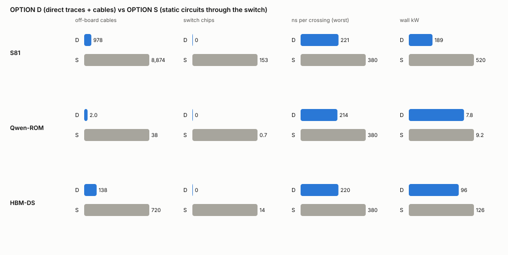
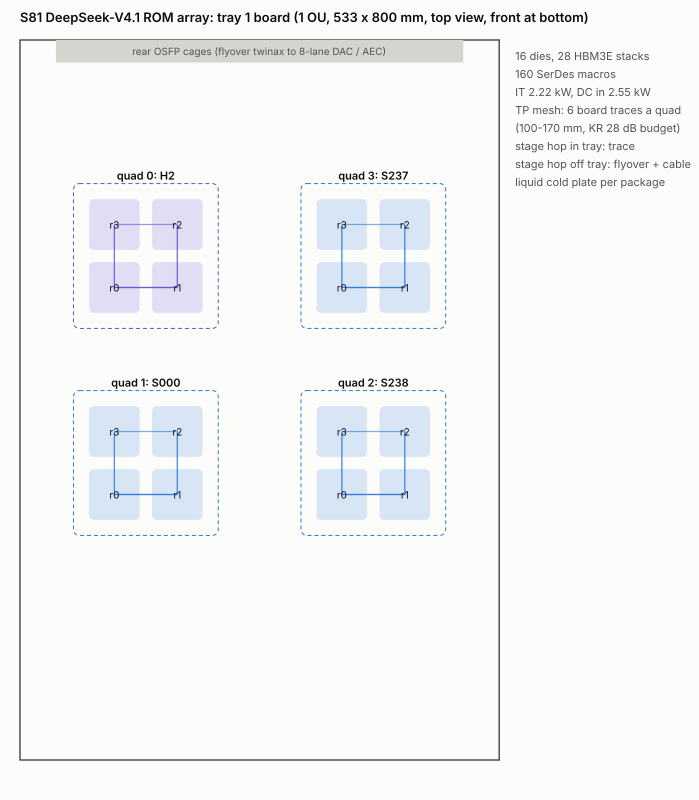
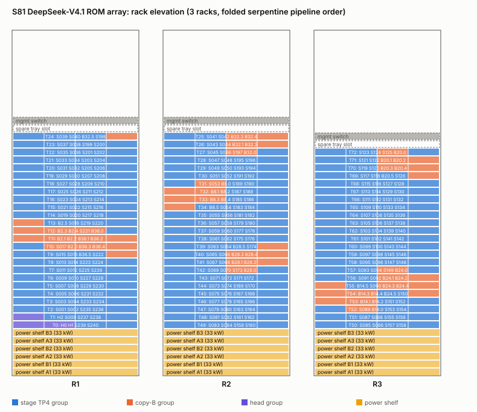
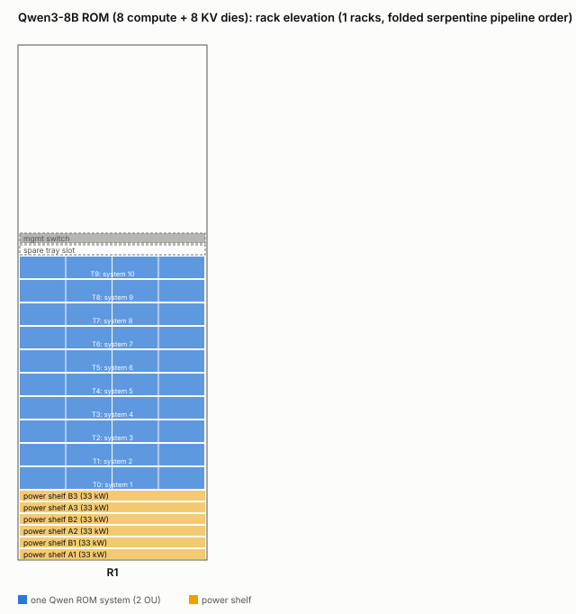
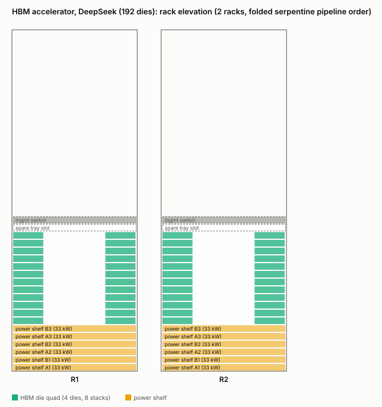

# Release rack design and wiring plan (RACK-1021)

OWNER request, 2026-10-21. This is a design deliverable, not a validation. It is analytical only: no simulation was run.

- Generator: `tools/release_rack_design.py`. Figures: `tools/release_rack_figures.py`.
- Outputs are in `results/arch/release_rack_1021/`:
  - `connections_<system>.csv`: one row per circuit;
  - `rack.json`: trays, racks, power, sparing, and the option comparison;
  - `hop_latency.json`: per-class hop latency for the token-pass static schedule;
  - `figures/`.
- Physical constants and their sources are reused from `tools/v41_rack_design.py` (PHYS). The old V4.1 rack study,
  [ARCH_V41_RACK.md](ARCH_V41_RACK.md), is the predecessor.

Every number carries one of four grades:
- **[pub]**: published by a vendor or standard;
- **[spec]**: a committed repo record;
- **[MODEL]**: an allocator model or an engineering estimate, not qualified;
- **[der]**: arithmetic on the above.

## 1. Summary

| | **OPTION D**: direct (board traces + cables) | **OPTION S**: static circuits through a one-tier switch |
|---|---|---|
| S81 cables off the board | **978** (942 passive DAC + 36 AEC; 24 of them are the head-tray host links) [der] | **8,874** AEC [der] |
| S81 switch chips | **0** | **153** Tomahawk-Ultra class in 5 switch racks [der/MODEL] |
| S81 latency per crossing | **209-221 ns** (251-266 cycles) [der] | **380 ns** (456 cycles). The budget is 377.6 ns, and 367 ns is reached only with passive DAC legs [der] |
| S81 wall power | **189 kW** [der] | **520 kW** (+230 kW switch trays, +89 kW AEC) [der/MODEL] |
| S81 per-user rate | **+12%** vs the 377.6 ns contract (534 crossings a token x 190-203 cycles saved) [der, 81-stage calendar] | today's contract |
| sparing | Tray swap, about 30 min [MODEL] | Hot re-point, about 1 s, but only onto a die that holds the same ROM [MODEL] |
| re-pointing | None: changing the copies needs re-cabling | Any circuit inside a switch-chip domain |

**Recommendation:**
- **S81 and Qwen ROM: OPTION D.** Every S81 circuit is static and peer to peer, so the switch buys nothing but re-pointing. It costs 2.8x the power, about 10x the cables, 5 extra racks and about 170 ns a crossing. Qwen ROM is already wired this way (K4 board, `results/arch/qwen_tp8_1012/SPEC.md`).
- **HBM-DS: OPTION S.** Its array collectives need any die to reach any die in one crossing. With 5 links per die, a direct topology can only be a ring of 48 quads, which makes an array-wide reduce about 14x slower [der].
- **HBM-Qwen:** the 8 dies share one package. Its links are in-package traces, and only the host link leaves the board.

## 2. S81 DeepSeek-V4.1 ROM array

### 2.1 Dies and links

| item | value | grade |
|---|---|---|
| stages / layer dies | **241 / 964**, the QUALIFIED 72-frame map `results/arch/s81_map72_1021/r2_241/stage_map_f72r224gpq_241.json` (static capacity receipt PASS, 6/6 exact chunks, ccff664a5). `s81_stage_map_input.json` points `stage_map_path` at it; the generator reads the stage count from it | spec |
| copy-B dies | 8 groups x 24 = **192**: the chain-plan rule `round(layer_dies / 40)` rounded up to whole TP4 groups. Each copy-A run starts at the first qualified-map stage holding its layer (R012/R048/R084/R120/R144/R168/R192/R216); the copy-B run length stays MODEL | MODEL |
| head dies | **12**, 4 HBM stacks each (10-06 rack record). No 72-frame head die exists yet | MODEL |
| total | **1,168 dies, 1,204 HBM3E stacks** | der |
| links on a rank die | **10 SerDes = 5 lane pairs**, the 5-circuit lane plan (`lanes/S81-LINK5.md`): s_0S pair A (WS0/1) <-> rank r-1 s_7S; s_7S pair A (ES0/1) <-> rank r+1 s_0S; TP d+2 = s_7N pair A (EN0/1) <-> rank r+2 s_7N pair A, one bidirectional circuit; stage NEXT = s_0N pair A (WN0/1) -> next stage, same rank, s_0N pair B (WN2/3); stage PREV = s_0N pair B (WN2/3) <- previous stage s_0N pair A (5th pair, OWNER 10-21). E column B (EN2/3) is the copy-A/B reserve and is unwired on ordinary rank dies | spec |
| copy-A/B dies | the 4 rank dies of each pre-group and post-group stage carry a 6th pair (the copy-A/B reserve: EN2/3 on pre-group dies, WS2/3 on post-group dies). That is **64 dies** with 12 SerDes | spec |
| host (S81.HOST) | direct cabling: the host attaches **only to the 12 head dies**, one extra SerDes pair (`lk_HOST0+1`) each on the head-die trays. Host traffic to stage dies (config, KV ingest, token in/out) rides in-band on the existing pipeline/stage circuits in calendar slots (20-30x bandwidth headroom). Stage dies have no host link: their s_7N host-plane port maps to the in-band route. Every tray has a low-rate management sideband (boot/config, I2C/SMBus + 1GbE BMC class) to the rack management switch; it is a `mgmt` row, not a SerDes | spec (coordinator decision) / MODEL lengths |
| one circuit | 2 SerDes macros, 2 x 512 b/cycle = **1,229 Gb/s raw, 939 Gb/s usable per direction**. That is 12 x 112G lanes; 6 lanes per macro is MODEL | spec / MODEL |
| traffic | TP circuit: about 4.2k beats a user-token, about 10% occupancy at 46 users. Stage hop: 652 cycles a user-position (h message 40,976 B a rank die), 3.1% at 46 users | der / spec |

**Circuits: 2,964 in total**, plus 73 per-tray `mgmt` sideband rows.
- 1,752 TP mesh (584 of them the d+2 EN<->EN circuits);
- 960 stage hops (s_0N A -> next s_0N B);
- 12 head hops and 4 token-return hops;
- 32 copy-B in, 160 copy-B internal and 32 copy-B out;
- 12 host links, head dies only.

Each row of `connections_s81.csv` gives:
- both endpoints: die id, TP unit, rank and SerDes macros;
- the lanes;
- the medium, length, loss, reach check, latency and cycles under OPTION D;
- the same under OPTION S;
- the traffic.

### 2.2 Tray and board

Each 1 OU ORv3 tray (533 x 800 mm) carries **4 quads of 2 x 2 single-die packages, which is 16 dies**.
- Each package holds one die and one HBM3E stack, about 55 x 55 mm on a 70 mm pitch [MODEL].
- **One TP4 group = one quad.** Its 6 mesh circuits are board traces of 100-170 mm, with 9.5-12.0 dB loss against the
  **KR 28 dB** budget [pub]. Loss is modelled as 0.9 dB/in ultra-low-loss stripline plus 3 dB of package per end [MODEL].
- A stage hop inside a tray is a 260 mm trace (15.2 dB).
- The pipeline turns around on the last tray with a 513 mm trace at 24.2 dB, which is in budget but has the least
  margin. Eight circuits do this; they can move to a flyover cable if the measured loss is higher.
- Off-tray circuits use near-package flyover twinax to rear OSFP cages, then 8-lane cables [MODEL].
- Trays are placed as a **folded ring**:
  - quads 0-1 carry the outgoing half of the pipeline and quads 2-3 the returning half;
  - every pipeline neighbour therefore sits in the same tray or the next one;
  - the ring (head -> S0 ... S240 -> head) closes inside tray 0.
  - The token return is a board trace.

### 2.3 Rack elevation

- There are **73 trays in 3 racks** (25 / 25 / 23), placed in serpentine order: R1 bottom to top, R2 top to bottom, R3 bottom to top.
- Each rack has:
  - 6 power shelves (3 + 3, 2N; 33 kW, 27.5 kW N+1 [pub]);
  - 1 spare tray slot;
  - 1 management switch.
- Racks are liquid cooled: a cold plate on every package, a rear manifold and an in-row CDU.
- OPTION D cable lengths:
  - adjacent trays: 1.3-1.39 m passive DAC (2 m reach [pub]);
  - the two rack-to-rack turns: 2.15-2.25 m AEC (7 m reach [pub]).
- No switch trays.

### 2.4 Power and thermal

| per tray | value | grade |
|---|---|---|
| 16 dies x 84.1 W | 1,346 W | spec: old 10-04 S81 die report, saturated. No 72-frame die power report exists yet |
| 16 HBM3E x 2.8 W | 45 W | spec |
| SerDes: 160 macros x 6 lanes x 112 Gb/s x 6.5 pJ/b | 699 W | der on pub. This may double-count if the die figure already includes the PHY |
| misc | 60 W | MODEL |
| **IT / DC input (VR 0.87)** | **2.28 / 2.62 kW** | der. A 1 OU liquid tray carries 5.5 kW today (NVL72 [pub]). The head trays add the host SerDes: up to 176 macros, 2.35 / 2.70 kW, the worst tray |

Per rack:
- **54 kW IT, 62 kW DC, 65 kW at the wall** [der].
- This is within one side's 82.5 kW.

Array total:
- **158 kW IT, 189 kW at the wall** (OPTION D);
- 520 kW at the wall (OPTION S).

### 2.5 Sparing

- **Fleet stock.** Every ROM die is unique, because its weights are in its masks. A spare must therefore be the same die
  type. Spares are held per tray type and shared by all deployed replicas, in both options.
- **OPTION D:**
  - one pre-plumbed spare slot per rack;
  - a failed tray is swapped in about 30 min [MODEL];
  - each 12-lane circuit rides two 8-lane cables, which leaves 4 spare lanes for PHY lane remap (a requirement on the SerDes macro);
  - the board-trace mesh has no spare.
- **OPTION S:**
  - a 1 s re-point is possible only onto a die that is already cabled and holds the same ROM;
  - in practice that means the copy-B groups, which can back up their copy-A groups at fewer MU users.

### 2.6 OPTION D vs OPTION S

| | D | S |
|---|---|---|
| cables | 978 | 8,874 (every die lane to a switch port; legs average 2.6 m, so AEC) |
| switch chips | 0 | 153: 139 by bandwidth (die lanes / 512) plus a 10% chip-domain boundary allowance. One crossing requires both circuit ends on one chip |
| racks | 3 | 3 + 5 switch racks |
| latency per crossing | 209 ns full KP4 hop (includes 0.3 m of flight [spec]) + flight + 3 ns AEC | 100 PHY/FEC + 250 switch [pub] + 2 legs of flight + 2 x 3 ns AEC = 380 ns |
| power on links | 0.4 kW AEC | 230 kW switch trays (1.5 kW each, MODEL) + 89 kW AEC |
| sparing | tray swap | hot re-point onto copy-B / standby groups |
| re-pointing | re-cable | table rewrite |

### 2.7 Hop latency for the static schedule

`results/arch/release_rack_1021/hop_latency.json` lists every circuit class with:
- D min/max (ns and cycles at 1.2 GHz);
- S;
- the 377.6 ns budget.

For S81 under OPTION D:

| class | D cycles |
|---|---|
| TP mesh and token return | **251** |
| stage hop | 251-266 |
| copy-B | 251-266 |

All of these replace the 453-454 cycles the xdie co-sims model today [der].

## 3. Qwen3-8B ROM

- **Dies.** 8 compute dies (841 mm²) and 8 KV dies (377.6 mm², 4 HBM3E each), in 4 CoWoS packages of 2 ROM + 2 KV + 8 stacks
  [spec: `SPEC.md` track A].
- **Links per compute die.** 3 x 112G-x12 SerDes, one per remote package, plus UCIe to its package mate and UCIe to its KV die [spec]. The KV die carries the host port.
- **Circuits: 25.**
  - 12 TP8 all-reduce SerDes circuits on board traces, 320-520 mm, 17-24 dB;
  - 4 ROM-pair UCIe and 8 ROM-KV UCIe, in package;
  - 1 host link (passive DAC).
- **Board.** One system fits on **one 2 OU tray**: 6.5 kW IT, 7.4 kW DC, or 3.7 kW per OU [der on MODEL die power: 527 W compute, 237 W KV, `s81_balance_1018/compute.py`].
- **Rack.** A rack holds **10 systems (40 users)**, 74 kW DC, plus a spare slot.
- **Options.** Qwen ROM is already OPTION D. Moving the 72 board crossings a token behind a switch would cost about 14k cycles of the 251,615-cycle token, about 6% [der].

## 4. HBM accelerator

**DeepSeek system:**
- **Dies.** 192 next-release dies (P = 3, 767.4 mm², OWNER 10-19) with 2 HBM3E each, 384 stacks [spec].
- **Links.** 5 SerDes links per die [spec, d4g: `lanes/TOKEN-XDIE-HBM.md`]. The P = 3 die is assumed to inherit them, which is not confirmed.
- **Die power.** 384 W [MODEL: 0.5 W/mm². The compute.py DS row's 65 W/die is inconsistent with this and is not used].
- **Layout.** 1 OU trays of 8 dies, 3.8 kW DC; 24 trays in 2 racks; 96 kW at the wall under OPTION D, 126 kW under OPTION S.
- **OPTION D shape.** The 5 links form a quad mesh plus a ring of 48 quads: 480 circuits, 138 cables. An array-wide reduce + broadcast then takes 48 ring hops, about 12.7k cycles, against 2 switch crossings (about 0.9k) [der].
- **Recommendation: keep OPTION S.** That is 14 switch chips and 720 cables.

**Qwen system:**
- **Dies.** 8 dies and 16 stacks in one package. The 3-link hypercube is in-package trace (3.3 ns [MODEL]); the topology is an open coordinator decision.
- **Rack.** One 1 OU tray (3.8 kW) per system, 20 systems a rack.

## 5. Comparison with published systems

| | S81 (D) | GB200 NVL72 [pub] | CloudMatrix384 [pub] |
|---|---|---|---|
| accelerators | 1,168 ROM dies (single model replica) | 72 B200 + 36 Grace | 384 Ascend 910C + 192 Kunpeng |
| racks | 3 | 1 | 16 (12 compute + 4 communication) |
| power | 189 kW wall | about 120-132 kW | about 559 kW |
| scale-up cables | 978 copper (942 passive) | over 5,000 active copper (NVLink cartridges) | optical, 2-tier UB switch |
| switch chips | 0 | 18 NVLink switch chips (9 trays) | 7 planes x 16 L2 switch chips |
| fabric | static point-to-point circuits, TP4 mesh on board | NVLink 5 all-to-all, 0.9 TB/s/GPU/dir | Unified Bus all-to-all, 392 GB/s/NPU/dir |

The release arrays wire a fixed, known traffic pattern. That is why S81 needs about a fifth of NVL72's cables and none of its switches, even though it spans 3 racks.

## 6. Open items

1. The stage map is qualified (ccff664a5). The copy-B run length and the head-die count are still MODEL.
2. No 72-frame die power report exists. SerDes power may double-count with the die figure.
3. The macro lane count (6 x 112G) is a placeholder abstract.
4. The trace loss model must be checked against the chosen laminate. The 8 turnaround circuits at 24 dB have the least margin.
5. HBM P = 3 link count and HBM-Qwen package topology are not confirmed.
6. Head-die draft fan-out links are not wired: they are placeholders.
