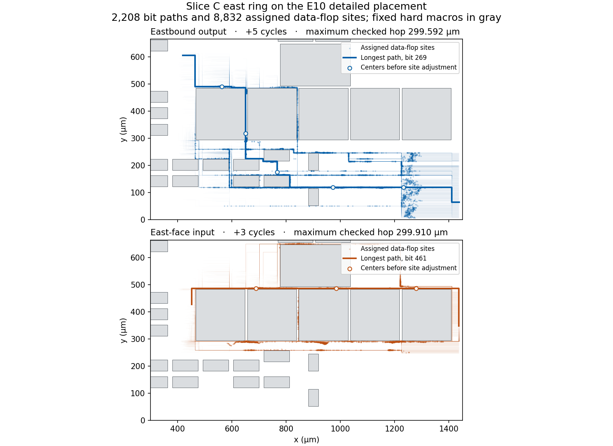

# Slice C east-ring station alternative

D8i E10 `dsdv_slice_kv512_C__t1/attempt_2` stays BAD for routing. On its fixed 1442.88 × 1278.72 µm outline, every auto-suggested east-ring station center falls inside a finish macro. This private alternative keeps both placed endpoints of each bit, adds full-width registered stations, and uses the current 300 µm data-hop cap.

| Directed link | Added cycles at 833 ps | Trial flop sites | Worst data segment after siting |
|---|---:|---:|---:|
| `xring__s_3N_C__s_4N_C` (output) | 5, or 4.165 ns | 5,525 | 299.592 µm, bit 806, segment 2 |
| `xring__s_4N_C__s_3N_C` (input) | 3, or 2.499 ns | 3,315 | 299.910 µm, bit 315, segment 1 |

Direct lower bounds already require these depths. Outgoing bit 269 spans 1,560.708 µm and incoming bit 439 spans 1,142.262 µm. There are 1,104 payload bits including in-band valid and a separate asynchronous-clear epoch per stage. The price is 8,840 flops, about 2,578 µm² of x1 RVT cell footprint before clock/reset buffers. A round trip through this pair adds 8 cycles or 6.664 ns. Each directed traversal must enter the static schedule exactly once. Token latency requires the actual serialized traversal counts.

All 8,840 trial footprints are on the 0.054 × 0.270 µm site grid, with 2.16 µm hard-macro keepouts, excluding occupied cells from the retained geometry export. An independent check covers all 2,208 payload paths, nonoverlap, macro-clear local connections and detour-length bounds. The eight epoch footprints reserve equivalent area. The outgoing RTL seeds epoch from `rst_n`; the incoming boundary captures it separately. The actual epoch source/reset paths must be bound in the pilot.

The cross-section at x = 940 µm takes 646 incoming bits south of the finish row, 285 through the finish-to-egg gap and 173 north of egg. The two narrow gaps respectively offer at most 634 and 631 one-track horizontal sites using this kit's M2/M4/M6 tracks and M8 grant. The first sketch put 538 bits in the first gap. Final data-only fractions in those gaps are 45.0% and 27.4%. The fixed grid starts with 74,706 assigned sinks on 40 taps. At 1,500 sinks/tap it needs at least 56 after the 8,840 new sinks, before the 300 µm clock region constraint. Existing `clk_t37` alone takes 10,808.

The E10 component proof used the original `ot_dp_st` module at full width, with unconstrained traffic and reset. It matches independent 3-cycle and 5-cycle histories after pipeline fill. Both a swapped-payload-bit mutant and a one-cycle-early-epoch mutant generated counterexamples at both depths. This covers the station mechanism. The attempt's nominal LEC success was an echo of `LEC_PREPLACE_DROPPED R-MINIMAL`.

This is a priced, site-checked alternative. Strict whole-kit LEC against the explicitly delayed contract, calendar repricing, complete DPL legality, physical clock/reset, TT setup ≥ −42 ps, FF internal hold ≥ 0 ps and related-pair skew remain open. The retained detailed placement's worst clocked path is a separate `xf.u_x.dl_d[318]` to finish core 3 at −1,603.42 ps. Parent plan and wave were untouched.

The exact input lies on epyc10 under `/srv/opentallas-scratch2/claude/kw43-wave-1109n/runs/s81/kit-wave/s81/465cb9fe2d3/items/dsdv_slice_kv512_C__t1/attempt_2`. The corresponding original `layout_review/place/layout.png` and `density.png` were visually reviewed. Reproducible scripts, six solver logs, generated bit paths and site coordinates are in `/srv/opentallas-scratch2/claude/opus-fix-s81-slicec/astra_e10_corridor_1120` on epyc10. The accepted scratch subdirectory is `final`. The proof guard unit was `oth-ubuntu-2434132-1795190858` and final site guard unit was `oth-ubuntu-160512-1795192784`, both RC 0. An intermediate site validator selected a new longest input bit as the representative epoch path. It rejected the old epoch coordinates. The final validator explicitly preserves the original representative, bit 445.

