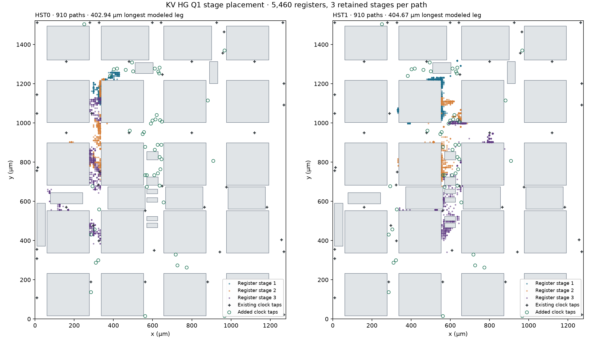

# KV HG Q1 register placement and tap capacity

This private model uses the exact retained HG 3_place ODB from the regional reset-tail trial. It moves the existing three data registers on each of 1,820 Q1-to-HST paths. It adds zero cycles. The packer used the real OpenDB rows, 117,510 fixed rectangles, all 5,460 target master footprints, and each D/Q pin's orientation. Every register has a unique legal site within 3.915 µm of its candidate center. The longest modeled obstacle-avoiding legs are 402.944 µm for HST0 and 404.667 µm for HST1.

The image shows HST0 using the west channel and HST1 using both sides of the center column. Some banks sit near a macro edge. Those rows need actual post-place density and clock-pair inspection before they can qualify for route. The proposed 49 additional clock taps preserve the 47 existing pin names and coordinates. Applying the kit's cap-reassignment algorithm to all 66,380 measured sinks with updated target positions gives a maximum load of 1,200 and longest tap-to-sink distance of 199.995 µm. Pure nearest assignment still peaks at 2,489 before redistribution.

Verdict PASS-COND for private placement work. The existing HG route hold remains in force.

Artifacts are in `intel2:/srv/opentallas-scratch2/claude/opus-fix-kv-hgi-r6/hg_residual_q1_hst`, including `q1_packed_candidate.json`, `q1_grid_repair.json`, and `q1_capacity_reassignment.json`.
