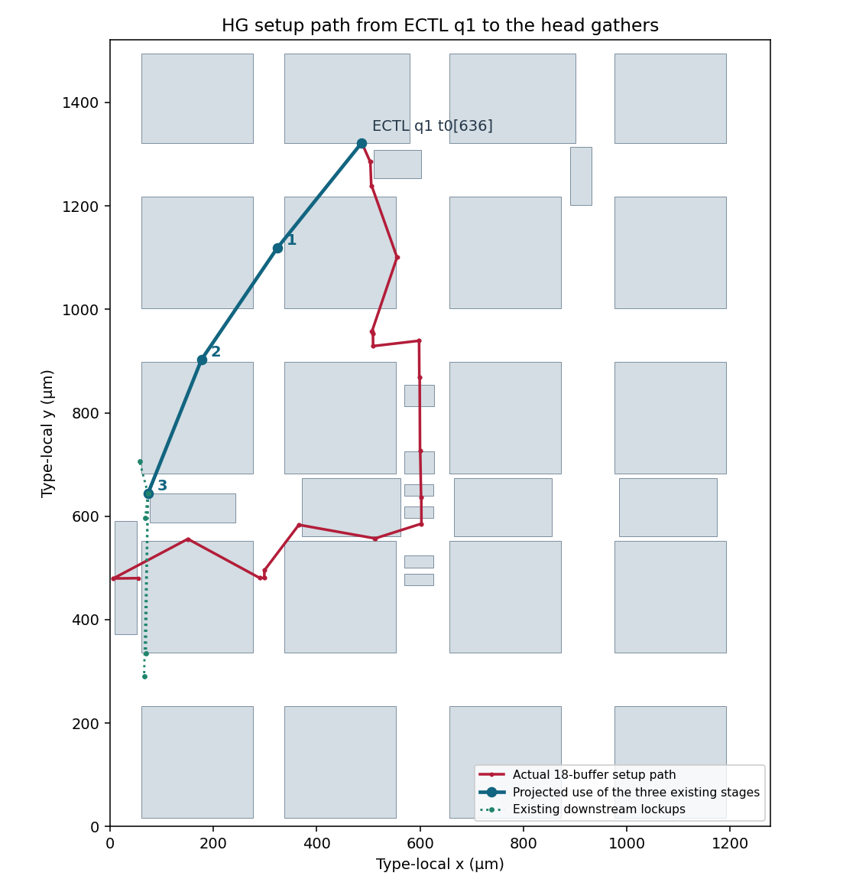

# HG and HGI timing after reset-tail localization

Viewed the exact HG private post-placement layout and density on E9, unit 1650474. Localized reset tails leave the earlier dominant reset path. Overall worst slack is −509.09 ps on ECTL q1 `t0[636]` to `u_hst0_g.u_reg.ti_b[1031]`. The 18-buffer path spans 1,915.76 µm through its placed pins. The endpoint separation is 1,274.63 µm and the next two existing gather stages are clustered within 19 µm of the endpoint. The central region remains crowded. This checkpoint stays at place.

Across 910 q1 bits feeding each of two head gather chains, the Manhattan projection moves the three existing registers onto sites outside the expanded macro boxes. Head 0 falls from 910 direct legs above 405 µm to one, and head 1 falls from 878 to zero. The named path falls from 1,273.84 to 366.36 µm in that model. Route detours, neighboring cell occupancy and actual timing remain to be resolved. There are zero added stages. Witnesses are in `intel2:/srv/opentallas-scratch2/claude/opus-fix-kv-hgi-r6/hg_residual_q1_hst`.

The separate D26 HGI v5 attempt AP `2992c3ce4f5c` stopped under the fleet policy at 16:31 PST, unit 234315 and exit 143, after TT estimate converged to −766.50 ps. Its exact viewed layout has 11 opposing-face pin flags and fanout spread of 1,611.6 µm. At CTS, the principal path is the negative reset lockup Q into head2_e6. The launch uses a deep `clk_t42` branch with 865.59 ps insertion and the macro capture uses direct `clk_c11` with 4.27 ps insertion. Data wire is 30.03 ps. The pre-hook report already fails at −653.26 ps. The subtree observer shows an ordinary 24–830 ps range and zero inserted subtree-delay cells on this path, separating this case from the timing-unit failure. Physical launch/capture pairing and the separate raw reset recovery path both remain open.
