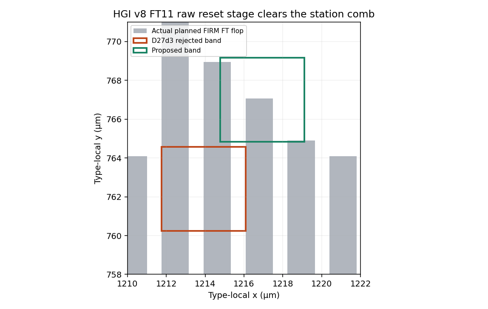

# D27d3 HGI v8 FT11 and reset-boundary proof

The exact D27d3 kit failed ordinary preflight before synthesis in Intel2 unit 2786419. The FT11 raw reset stage `fs_ft11_o[2]`, representing `rst_rl_48`, occupied a band crossed by 34 FIRM station cells. Its best free run in fifteen rows was 0.756 µm, below the 1.188 µm cell width.

The private delta moves the stage center from [1213.920, 762.408] to [1216.944, 766.998] µm. Every candidate row has at least 1.620 µm clear. The neighboring stage spans are 256.25 and 265.43 µm. The reset chain, exported ports and latency remain identical. Unit 2906241 passed ordinary kit preflight and synthesized, exposing the separate reset face guard.

The literal reset `ri_head2_u_score_rst_n[0]` drove the two pre-synchronizer clear pins and 33 clear pins on eleven three-stage tails. Both the mapped and synth ODB face checks reported this as the sole shared bit. The private retarget sends the synchronizer Q to each tail's asynchronous clear and keeps its existing D connection. The common Q itself clears asynchronously. A bench using the exact two-stage/eleven-tail combination passed 484 checks, including short pulses, stopped clocks at both polarities, and fifth-edge release. The synchronous-clear and early-release mutants failed. Intel2 synthesis unit 3824043 passed all 12,413 face bits and the register fanout screen.

The two deltas need a coherent plan and generated-kit successor, then actual physical evaluation of the internal Q-to-clear recovery path. Current D27d3 v8 stays held. Evidence is in `intel2:/srv/opentallas-scratch2/claude/opus-fix-kv-hgi-r6/d27d3_hgi_v8_face_exact`.
