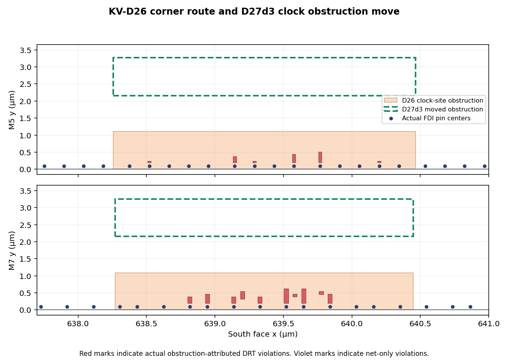

# KV-D26 corner FDI route review

Viewed the exact D26 placed layout and routed wires for AP `0c4c31159c90` on E8. The route is unsigned with 54 DRT markers. Every marker names an `i_host_fdi` net. The south x638.28–640.44 µm clock-tree reserve emitted permanent M1–M7 obstructions overlapping 14 M5 and 13 M7 FDI pin centers. Exact same-layer obstruction rectangles intersect 44 report markers. Two additional markers cite other obstructions, and eight are net-only.

The D27d3 source already raises the exact reserve and stack from y0–1.08 to y2.16–3.24 µm. The new site intersects zero old same-layer markers and zero FDI pin centers. The baseline `kv3_io_cor` requires its own exact placed review and ordinary DRT/signoff. The independent `kv3_io_cor_v1` GEN/PIN_SITE result covers its separate FT11 correction.

Retained input: `epyc8:/srv/opentallas-scratch2/claude/kw43-wave-1109/runs/qwen_kvsys/kit-wave/qwen_kvsys/KV-D26/items/kv3_io_cor/gen/kv3_io_cor`. Report: `run/reports/asap7/dp_kv3_io_cor/base/5_route_drc.rpt`. Actual views: `run/layout_review/place/layout.png`, `run/layout_review/route/wires.png`.
