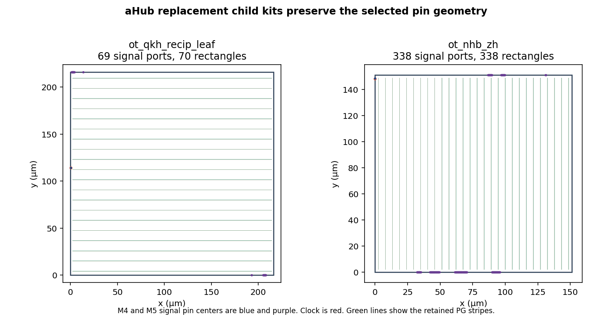

# aHub replacement child pre-placement review

The selected legacy ZH and RECIP abstracts lack their original routed child graph and cannot close the parent child-ETM gate. The two new private kits use the recovered source closures and the same signal pin coordinates and sizes. Their M4/M5 track phase is 0.012 µm on the 0.048 µm grid. Matching legacy PDN recipes retain M6 PG for RECIP and M5 PG for ZH.

Viewed and accepted for private placement. The RECIP kit has 69 signal ports and 70 rectangles. Both `x[31]` rectangles belong to one BPin, addressing the earlier DRT-0302 input representation. The ZH kit has 338 signal ports and 338 rectangles. Pin matching is against the actual selected LEFs. The green PG stripes in the picture come from the retained LEFs and will be compared to the realized DB. The new child models need their own exact placed review, DRT, signoff, and paired parent import before adoption.

Kit hashes: RECIP `11200a12e7ec789a`, ZH `f9647d34cb7da40f`. Inputs and private GEN: `intel2:~/tmp/fablefixkvhub-r4/child_gen/{recip,zh}/kit_recovered_pg`.
