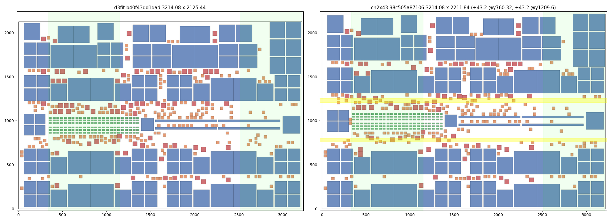
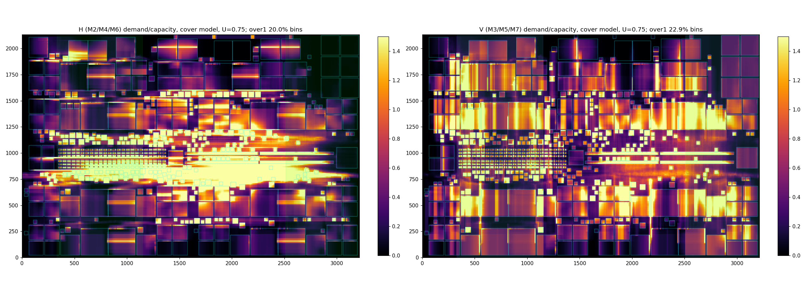

# S81 t2B routing-demand estimate + channel re-floor (S81-KVLEAF-T2-ARCH, 11-24)

Estimator (intel1 `s81-kvleaf-t2-arch/rde`: rde_dump.py, rde.py, cutcount.py, cut_census.py) on the placed v5d probe_v8 (3214.08 x 2134.08),
cover-OBS capacity model (masters block M2-M5 over footprint, SRAM M1-M4, PDN derate, U=0.75 = GRT 25 % layer adjustment).

- Exact cut-line demand / capacity: H 0.91 at x=1966 (38,908 nets), V 0.94 at y=572 (55,387 incl. 6,823 ft corridor bits).
- Local: spine band y750-900 at 5-17x H (RUDY map `t2b_rde_v8.png`); 80 % of the nets crossing x=1966 are kvi->kvi / kvx->kvx relay hops.
- Master LEFs carry 15k-39k shape OBS rects each -> 3.4M GRT blockages and false M2-M5 capacity over the masters; the v8/v9 GRT stalls come from that.
- Sizing to 0.85 at the worst cut: +70 um channel height (H), +126 um width (V; or move the ft corridors out of B).

Fix drawn: `t2b_seats_d3fit_ch2x43_1124.json` 98c505a87106 = d3fit b40f43dd1dad + two 43.2-um horizontal routing channels (y760.32, y1209.6), 2211.84 tall,
XD/KST/XST unchanged, 0 overlaps, inter-relay hop <= 401.8, last kvi -> engine 391.0, last kvx -> farthest store word 469.6 (= d3fit). One-channel form
(y760.32, 2168.64) has inter-relay <= 388.8. Cover-OBS abstracts (cover_obs.py). Probe probe_v10 (intel1, place+CTS+GRT) running.

Die price (rigid_refloor, D3 49332d346d48): +43.2 (cols 2-4 C/L1/L3/L4 +43.2, x06 station rows -43.2 tall, gunit/bk_sel fixed) blocks only on
3 NO-ROOM seams: xring s_5N_C|s_4N_C, xring s_2N_C|s_1N_C (already 184.03 um at 6 pins/um) and x_W4_in__1. +86.4 adds ca/cb s_0N_LP|bk_sel.

 
